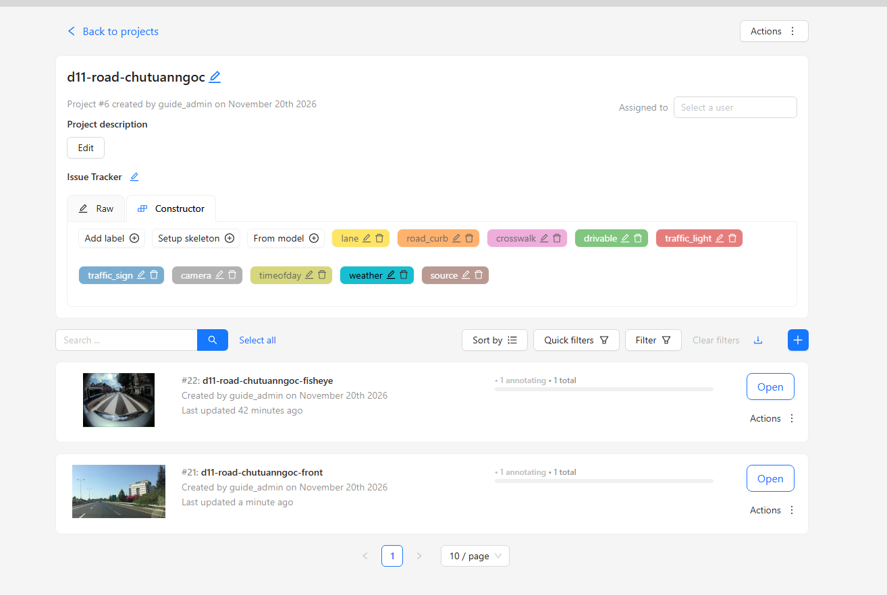
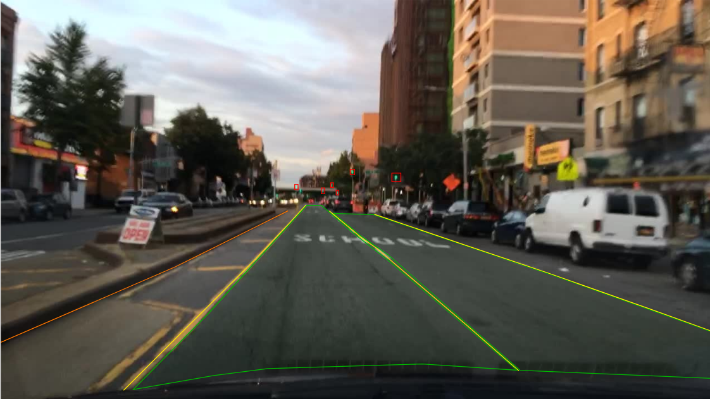
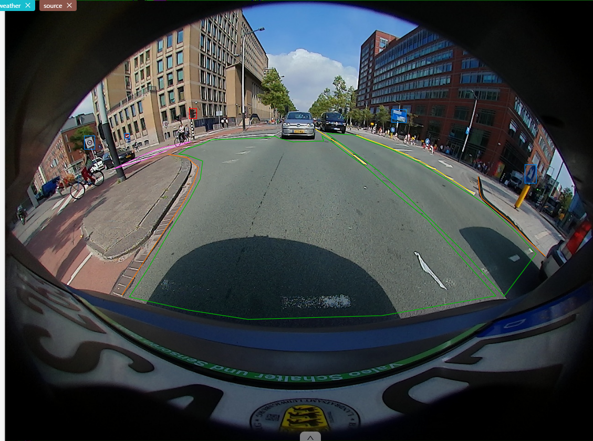
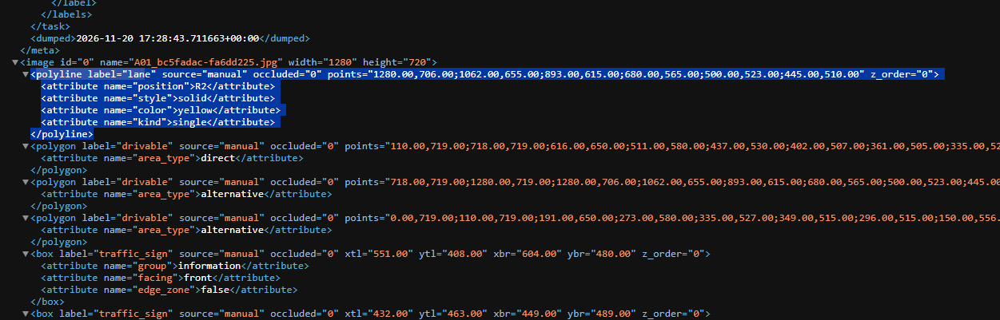

# Báo cáo cá nhân — Ngày 11
Họ tên: Chu Tuấn Ngọc               Mã học viên: 2A202603234
Phiên bản CVAT (Help → About): 2.74.1
Guideline: Road v1.0    Lần nộp (`revision` trong manifest): 1
Thời điểm export (ngày giờ trên CVAT): 2026-11-20 17:28 UTC (00:28 ngày 21/11 giờ VN)    Số lần nộp lại sau Rework: 0

> Ghi chú: bài làm trên CVAT local (Docker), không dùng app.cvat.ai. Một phần fisheye (B01–B12) được gán trên máy khác, export CVAT 1.1 rồi gộp và import vào task fisheye; tên ảnh giữ nguyên.

## 1. Kiểm project
| Mục | Đúng như guideline Road v1.0? | Ghi chú |
| --- | --- | --- |
| 6 label, đúng kiểu | Có | lane, road_curb (polyline); crosswalk, drivable (polygon); traffic_light, traffic_sign (rectangle). Dán từ `python -m road_lab.taxonomy` vào tab Raw. |
| Thuộc tính và giá trị | Có | Đối chiếu label trên CVAT với taxonomy bằng script: khớp 100 %. |
| 4 tag ảnh | Có | camera, timeofday, weather, source; mỗi label Tag có một thuộc tính select `value`. |

Cách kết thúc polyline trên bản CVAT này: đặt điểm bằng chuột trái, nhấn **N** (hoặc nút Done) để kết thúc; sau đó mở Details sửa thuộc tính (mặc định CVAT điền `L1 / solid / white / single`).
Cách đặt tag ảnh trên bản CVAT này: công cụ **Setup tag** ở thanh trái → chọn label (camera, …) → đặt `value` trong Details của tag ở panel Objects.

## 2. Số lượng đã gán
| Task | Ảnh | lane | road_curb | crosswalk | drivable | traffic_light | traffic_sign |
| --- | ---: | ---: | ---: | ---: | ---: | ---: | ---: |
| front | 12 | 24 | 6 | 1 | 22 | 32 | 12 |
| front-extra (đã làm 4 / 4) | 4 | 10 | 0 | 0 | 8 | 8 | 12 |
| fisheye | 8 | 11 | 15 | 13 | 13 | 6 | 7 |
| fisheye-extra (đã làm 4 / 4) | 4 | 0 | 7 | 5 | 6 | 1 | 1 |

## 3. Bảng ca khó
| Ảnh | Nhãn | Phân vân giữa | Đã chọn | Lý do |
| --- | --- | --- | --- | --- |
| A05 | lane L1, R1 | vẽ vạch / để trống | để trống | Đường phố không kẻ vạch. Lint báo QC1-02, **chờ coach xác nhận miễn**. |
| A06 | lane L1, R1 | vẽ vạch / để trống | để trống | Dưới cầu cạn, chỉ có vạch ngựa vằn ngang đường, không có vạch dọc làn. Chờ coach xác nhận. |
| A07 | lane L1 | vẽ vạch / để trống | để trống | Bên trái làn là dải phân cách bê tông, không có vạch sơn. Chờ coach xác nhận. |
| A08 | lane L1 | vẽ vạch / để trống | để trống | Giao lộ, không có vạch bên trái làn đang đi. Chờ coach xác nhận. |
| A09 | lane R1 | vẽ R1 / road_curb | road_curb | Mép phải là vỉa hè không sơn. Chờ coach xác nhận miễn QC1-02. |
| A10 | lane R1 | đoán vị trí / để trống | để trống | Phía phải làn bị xe che kín, không thấy vạch. Chờ coach xác nhận. |
| A14 | lane R1 | vẽ vạch bên phải / để trống | để trống | Ban đêm; vạch trắng thấy ở bên phải không song song với làn đang đi (thuộc đường khác). Chờ coach xác nhận. |
| A09 | lane L2 | 2 polyline / 1 polyline | 1 polyline, kind = double | Vạch trắng đôi liền là một vạch; đặt polyline ở giữa hai vệt sơn. |
| A11, A14 | lane L1 | 2 polyline / 1 polyline | 1 polyline, yellow, kind = double | Vạch vàng đôi tim đường là một vạch. |
| A02 | tag timeofday | day / dusk | day | Nắng thấp, bóng dài nhưng trời còn xanh, đủ sáng: vẫn là ban ngày. |
| A16 | tag timeofday | day / dusk | dusk | Ánh sáng yếu, đèn trong toà nhà và đèn xe đã bật: chạng vạng. |
| B05–B08 | lane position | L1/L2 / other | other | Camera hai bên (MVL/MVR): guideline bắt buộc position = other. |
| B02, B03, B04, B05, B10 | edge_zone | bật / tắt | bật | Tâm box ngoài 80 % bán kính vòng ảnh (bán kính = nửa chiều rộng ảnh, theo lint). |
| B03 | lane R1 | kéo R1 tới vệt trắng gần xe / dừng ở vệt xa | dừng ở vệt xa | Vệt trắng gần xe là mũi tên chỉ hướng, không thuộc vạch R1. |
| B11 | lane | gán vạch ô đỗ / không gán | không gán | Vạch ô đỗ (kể cả ô người khuyết tật) không phải lane theo mục 4 guideline. |

Ảnh chứng minh cho 7 ca QC1-02: `evidence/chutuanngoc-qc1-02-evidence.jpg` (gửi kèm cho coach).

## 4. Phiếu QC 1 nhận được
Bạn kiểm lô của tôi: _(điền)_  Quyết định nhận được: _(điền)_
| Mã lỗi | Số lỗi | Đồng ý? | Đã sửa? |
| --- | ---: | --- | --- |
| | | | |

Tự kiểm trước khi đổi lô (self-QC bằng `road_check lint`), đã sửa:
- QC1-03 (nặng): 8 lane ở B05–B08 để L1/L2 → đổi thành `other`.
- QC1-05 (chính): vạch đôi bị tách 2 polyline ở A09, A11 → gộp 1 polyline `kind = double`; nhiều polyline cùng L1 ở A02, A13, A15 → sửa position (R1/R2); A16 vạch phải làn đang đi để R2 → R1.
- QC1-04 (chính): A11 R1 vẽ từ xa về gần → đảo chiều.
- QC1-11 (chính): bật edge_zone cho 7 box fisheye; road_curb B02 thêm điểm theo cung (≥ 4 điểm).
- QC1-08 (nhẹ): bỏ 3 box đèn cao dưới 8 px (A03, A07).
- A14: bổ sung L1 vạch vàng đôi bị bỏ sót.

Lint sau khi sửa: 28 ảnh, 0 chính, 0 nhẹ, 9 nặng (đều là QC1-02 ở 7 ảnh trên, chờ coach xác nhận).

## 5. Kiểm file export
| File | Mở lại được? | Số shape ảnh 1 (job / file) | Số shape ảnh 2 (job / file) | Tag camera có trong XML? |
| --- | --- | --- | --- | --- |
| chutuanngoc-front.zip | Có (`road_check lint`) | A01: 9 / 9 | A02: 7 / 7 | Có, 16/16 ảnh |
| chutuanngoc-fisheye.zip | Có (`road_check lint`) | B01: 6 / 6 | B02: 8 / 8 | Có, 12/12 ảnh |

Manifest `chutuanngoc-manifest.json`: revision 1, sha256 của hai zip khớp, `contains_images = false`, 28/28 ảnh đủ bốn tag, 0 ảnh chưa gán.

## 6. Ảnh chụp màn hình
1. Tab Labels của project: 
2. Một ảnh camera trước đã gán đủ (làn, vùng lái, đèn/biển): A01 — 
3. Một ảnh fisheye đã gán, phóng to đoạn polyline cong: 
4. Một đoạn XML có `<polyline label="lane">`: 

```xml
<polyline label="lane" source="manual" occluded="0" points="110.00,719.00;191.00,650.00;273.00,580.00;335.00,527.00" z_order="0">
  <attribute name="position">L1</attribute>
  <attribute name="style">dashed</attribute>
  <attribute name="color">white</attribute>
  <attribute name="kind">single</attribute>
</polyline>
```

## 7. Tự đánh giá
Lỗi bạn mắc nhiều nhất hôm nay (theo mã QC1-xx), và cách tránh ở Ngày 20: QC1-03 và QC1-05. Nguyên nhân chung là CVAT tự điền `position = L1` cho mọi polyline mới và không sửa lại trong Details, nên ở camera hai bên vẫn để L1/L2, và ở vạch đôi có hai polyline cùng L1. Ngày 20 sẽ sửa thuộc tính ngay sau mỗi polyline, và chạy `road_check lint` sau mỗi 4–5 ảnh thay vì cuối buổi.

Nhãn của bạn đi vào model ở đâu? Chọn một lỗi đã sửa và nói nó làm model học sai thế nào: polyline lane được lấy mẫu thành đích row-anchor (x theo từng hàng) cho model phát hiện làn, và `position` cho biết vạch nào là biên làn đang đi (L1/R1) mà LKA dùng để giữ xe giữa làn. Nếu ở ảnh camera hông vẫn để L1 (lỗi QC1-03 đã sửa ở B05–B08), model học rằng một vạch nhìn từ bên hông là biên trái của làn đang đi; khi ghép đa camera, hệ thống có thể đặt sai biên làn và LKA lái lệch.

## 8. (Tùy chọn, buffer) Từ polyline đến đích row-anchor
_(Không làm.)_
